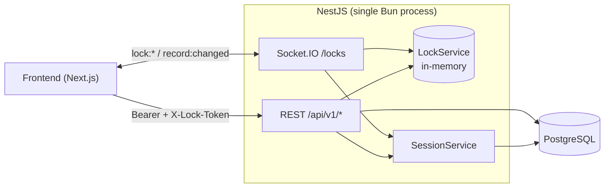
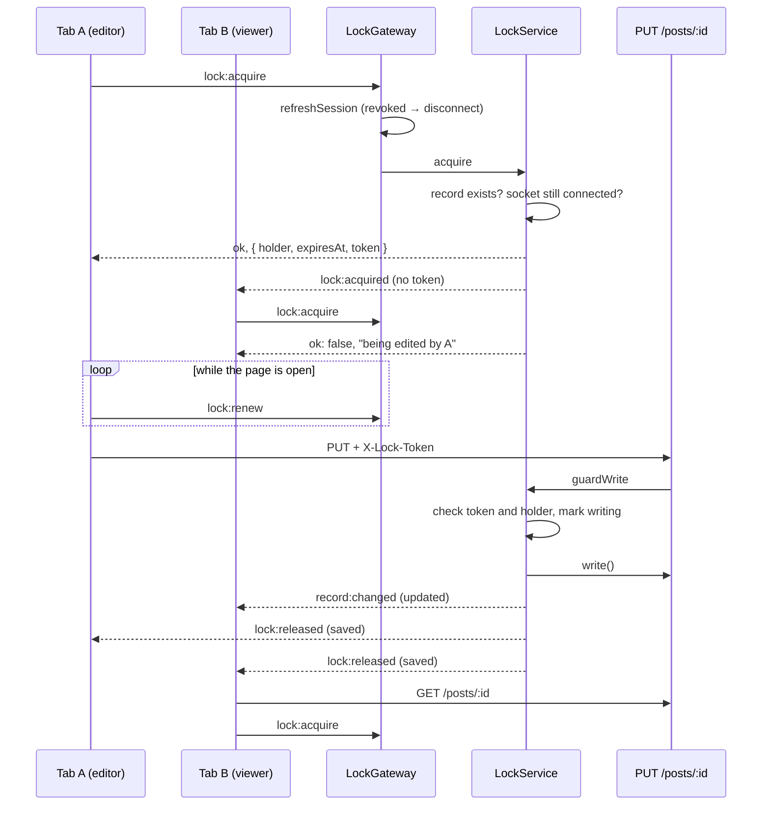

# Architecture

## Overview



- REST and WebSocket share one port and one process.
- Lock state lives in `LockService` memory; there is no lock table.
- Both channels authenticate through `SessionService`, so token revocation
  and role changes apply to both immediately.

## Modules

| Module                  | Responsibility                                        |
| ----------------------- | ----------------------------------------------------- |
| `AppModule`             | Global filter, interceptors, pipe, guard              |
| `PrismaModule` (global) | `PrismaService` with the pg adapter                   |
| `auth/jwt`              | Token signing and verification                        |
| `auth/session`          | Token → session, revocation check                     |
| `auth`                  | register, login, refresh, logout                      |
| `user`, `role`          | Administration and role hierarchy rules               |
| `post`                  | Post CRUD; writes go through `LockService.guardWrite` |
| `lock`                  | `LockGateway` (Socket.IO) and `LockService` (state)   |
| `health`                | Database ping                                         |

Any module whose controllers use `@Auth()` must import `SessionModule`.

## HTTP request pipeline

```
helmet, CORS
→ ThrottlerGuard (global, 100/min per IP and route)
→ JwtAuthGuard (@Auth) → SessionService.load
→ RolesGuard (@PreAuthorize)
→ GlobalValidationPipe (Zod, 400 with errors[])
→ Controller → Service
→ AuditLogInterceptor (createdBy/updatedBy/assignedBy ids → full names)
→ ZodSerializerInterceptor (strips fields not in the response DTO)
→ ApiResponseInterceptor (wraps in { success, statusCode, timestamp, data, meta? })
Errors → GlobalExceptionsFilter (maps Prisma P2002/P2003/P2025, hides 500 details)
```

- Routes use the `/api` prefix and URI versioning. `@Endpoint()` sets the
  version (default `'1'`), so every route must use it.
- Global guards, pipes and interceptors do **not** apply to gateways.
  `LockGateway` does its own authentication, validation and rate limiting.

## Authentication

- Tokens carry only `sub` and `tokenVersion`. Roles and active status are
  read from the database on every request and socket event that checks the
  session.
- Incrementing `User.tokenVersion` revokes all of the user's tokens. Login,
  refresh, logout, user update and user toggle all increment it, so **each
  login ends the user's other sessions**.
- Refresh tokens are single-use: the version check and increment are one
  atomic `updateMany`.
- Role hierarchy (`RoleRank`): OWNER > ADMIN > MANAGER > USER. Non-owners can
  only manage users, and assign roles, ranked below their own.

## Lock subsystem

### State

| Structure     | Key → value                | Purpose                                          |
| ------------- | -------------------------- | ------------------------------------------------ |
| `locks`       | `"post:42"` → `TLockEntry` | Active lock: holder, socketId, token, idle timer |
| `socketLocks` | `socketId` → `Set<key>`    | Release every lock of a tab on disconnect        |
| `writing`     | `Set<key>`                 | Records with a write in flight; cannot be locked |

Keys come from `keyOf(canonical(target))`. `canonical()` reduces an id to one
spelling (`'01'` → `'1'`), so one record cannot be locked under two keys.

### Atomicity

`acquire` awaits the database existence check, then runs the "is it locked?
→ lock it" block with **no `await`**. Because the event loop is single
threaded, two concurrent acquires cannot interleave inside that block and
only one wins. Adding an `await` there breaks the lock.

### Acquire and save flow



### `guardWrite` decisions

| Lock state                              | `PUT` (updated) | `DELETE` (deleted) |
| --------------------------------------- | --------------- | ------------------ |
| No lock                                 | **428**         | Allowed            |
| Held by this tab (token and user match) | Allowed         | Allowed            |
| Held by the same user's other tab       | **423**         | **423**            |
| Held by another user                    | **423**         | **423**            |
| Write in flight                         | **423**         | **423**            |

On success, `record:changed` is emitted first, then the lock is released
with `saved` or `deleted`. On failure the lock stays.

### Release reasons

| `reason`       | Trigger                                              |
| -------------- | ---------------------------------------------------- |
| `released`     | Client sent `lock:release`                           |
| `saved`        | Successful `PUT`                                     |
| `deleted`      | Successful `DELETE`                                  |
| `disconnected` | Socket closed (tab closed, network, revoked session) |
| `expired`      | No `lock:renew` for `LOCK_IDLE_TIMEOUT_MS` (5 min)   |

`lock:released` goes to the resource room and to the holder's socket.

### Adding a lockable resource

1. Add it to `LockResource` in [LockConstant.ts](../src/shared/constants/LockConstant.ts).
2. Add a `case` to `LockService.canonical()` and `resolve()`. Both switches
   are exhaustive, so the compiler flags the missing case.
3. Wrap the resource's update and delete in `guardWrite` and read
   `@Headers(LOCK_TOKEN_HEADER)` in the controller.
4. Add tests to `LockService.spec.ts`.

## Scaling limits

The current design supports **one instance**.

| Concern           | Now                       | For multiple instances                       |
| ----------------- | ------------------------- | -------------------------------------------- |
| Lock state        | Process memory            | Redis `SET key NX PX`, token-checked delete  |
| Socket broadcast  | One process               | `@socket.io/redis-adapter` + sticky sessions |
| HTTP rate limit   | Throttler in-memory store | Redis storage                                |
| Socket rate limit | `LockGateway` memory      | Redis                                        |
| Restart           | All locks are lost        | Persisted in Redis                           |
