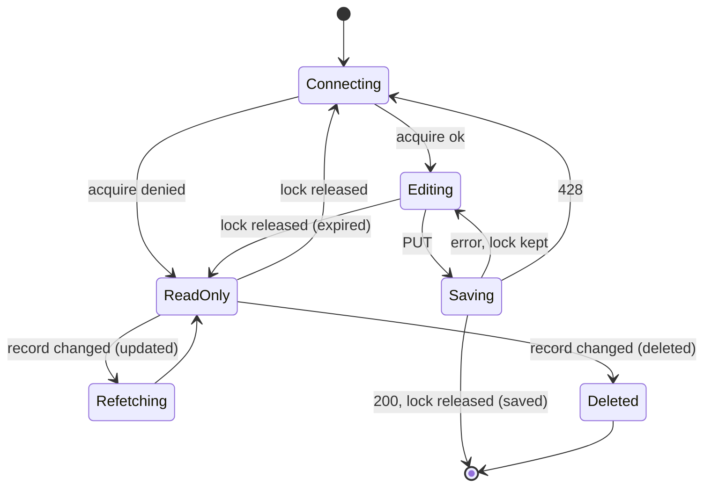

# Design System — API Contract

This repository is a backend, so it has no visual design system. This
document is the contract between frontend and backend: the conventions every
endpoint and event follows, and the lock UI states the frontend implements.

## REST

### Routes

Base path `/api/v1`. Plural, lowercase resource names. Static routes (`/all`,
`/me`) are declared before `/:id`.

| Operation      | Route                                                         | Status |
| -------------- | ------------------------------------------------------------- | ------ |
| Paginated list | `GET /resources?offset=&limit=&searchTerm=&sortBy=&isActive=` | 200    |
| Full list      | `GET /resources/all?isActive=`                                | 200    |
| Single record  | `GET /resources/:id`                                          | 200    |
| Create         | `POST /resources`                                             | 201    |
| Update         | `PUT /resources/:id` (partial: omitted fields are unchanged)  | 200    |
| Toggle active  | `PATCH /resources/:id/toggle`                                 | 200    |
| Delete         | `DELETE /resources/:id`                                       | 200    |

Writes return `data: null`. Pagination: `offset` ≥ 0 (default 0), `limit`
1–100 (default 10), `sortBy` `asc` | `desc`.

### Success envelope

```json
{
  "success": true,
  "statusCode": 200,
  "timestamp": "2026-10-12T13:06:34.240Z",
  "data": { "id": 2, "title": "Draft" },
  "meta": {
    "total": 42,
    "count": 10,
    "offset": 0,
    "limit": 10,
    "currentPage": 1,
    "totalPages": 5,
    "hasNext": true,
    "hasPrevious": false
  }
}
```

`meta` is present only on paginated lists.

### Error envelope

```json
{
  "path": "/api/v1/posts/2",
  "timestamp": "2026-10-12T13:06:34.240Z",
  "success": false,
  "statusCode": 400,
  "error": "Bad Request",
  "message": "Validation failed",
  "errors": [
    {
      "property": "title",
      "message": "Too small: expected string to have >=1 characters"
    }
  ]
}
```

`errors` is present only on validation failures.

### Status codes

| Code    | Meaning                                           | Frontend action                     |
| ------- | ------------------------------------------------- | ----------------------------------- |
| 400     | Validation failed                                 | Show `errors[]` per field           |
| 401     | Token missing, invalid, expired or revoked        | Refresh, otherwise go to login      |
| 403     | Role not allowed                                  | Show a permission message           |
| 404     | Record not found                                  | Show not found                      |
| 409     | Unique conflict, record in use, concurrent change | Show `message`                      |
| **423** | Record is locked by another tab, or being saved   | Switch to read-only, show `message` |
| **428** | `PUT` sent without holding the lock               | `lock:acquire` again, then retry    |
| 429     | Rate limited                                      | Wait and retry                      |

### Headers

| Header                                | Used on                                                |
| ------------------------------------- | ------------------------------------------------------ |
| `Authorization: Bearer <accessToken>` | Every authenticated route                              |
| `X-Lock-Token: <token>`               | `PUT` / `DELETE /posts/:id`, token from `lock:acquire` |

### Data formats

- Dates are ISO 8601 strings. User and role ids are cuids; post ids are
  positive integers.
- `createdBy`, `updatedBy` and `assignedBy` contain the user's **full name**.
- Request bodies are strict: unknown fields return 400.

## WebSocket

### Connection

```ts
io(`${API_URL}/locks`, { auth: { token: accessToken } });
```

The `/api` prefix does not apply. A missing, invalid or revoked token fails
with `connect_error: Unauthorized`. Reconnect with the new token after a
refresh. Limit: 30 events per 10 seconds per socket.

### Acknowledgements

Every client event is sent with `emitWithAck` and answered with:

```ts
type TLockAck<T> =
  { ok: true; data: T } | { ok: false; error: string; lock?: TEditLock };

type TEditLock = {
  resource: 'post';
  id: string;
  holder: { userId: string; fullName: string };
  acquiredAt: string;
  expiresAt: string;
};

type TLockGrant = TEditLock & { token: string }; // holder only
```

### Client → server

| Event          | Payload            | `data` on success | When                               |
| -------------- | ------------------ | ----------------- | ---------------------------------- |
| `lock:watch`   | `{ resource }`     | `TEditLock[]`     | List or detail page opens          |
| `lock:unwatch` | `{ resource }`     | —                 | Page closes                        |
| `lock:acquire` | `{ resource, id }` | `TLockGrant`      | Detail page opens; after a release |
| `lock:renew`   | `{ resource, id }` | `TEditLock`       | Every 1–2 minutes while editing    |
| `lock:release` | `{ resource, id }` | —                 | Leaving without saving             |

`id` is sent as a string (`'42'`).

### Server → client

| Event            | Payload                            | Meaning                                                           |
| ---------------- | ---------------------------------- | ----------------------------------------------------------------- |
| `lock:acquired`  | `TEditLock`                        | A record was locked                                               |
| `lock:released`  | `{ resource, id, reason }`         | `released` \| `saved` \| `deleted` \| `expired` \| `disconnected` |
| `record:changed` | `{ resource, id, action, by, at }` | `action`: `updated` \| `deleted`                                  |

After a save the order is always `record:changed`, then `lock:released`.

### Error messages

| Message                                                     | Source               | Meaning                                 |
| ----------------------------------------------------------- | -------------------- | --------------------------------------- |
| `This record is currently being edited by <name>.`          | acquire, `PUT` (423) | Another user holds it                   |
| `You are already editing this record in another tab.`       | acquire              | Your other tab holds it                 |
| `You are editing this record in another tab.`               | `PUT` (423)          | This tab has no token                   |
| `This record is being saved. Please try again.`             | acquire, `PUT` (423) | Write in flight                         |
| `Your edit lock has expired. Reopen the record to edit it.` | `PUT` (428)          | No lock                                 |
| `You do not hold the lock on this record.`                  | renew                | The lock was dropped                    |
| `Record not found.`                                         | acquire              | Missing record or bad id                |
| `Unauthorized.`                                             | acquire, renew       | Session revoked; socket is disconnected |

## Lock UI states



| State                   | Form     | Message                                            |
| ----------------------- | -------- | -------------------------------------------------- |
| ReadOnly (another user) | Disabled | "This record is being edited by `holder.fullName`" |
| ReadOnly (same user)    | Disabled | "You are editing this record in another tab"       |
| Deleted                 | —        | "This record was deleted", return to the list      |

Rules:

1. On `lock:released`, finish any pending refetch before sending
   `lock:acquire`.
2. Send `lock:renew` periodically while editing.
3. Send `lock:release` when leaving without saving. Not needed after a save.
4. Keep the lock token in tab memory only; never share it across tabs.
5. Filter every event by `resource` and `id`.
